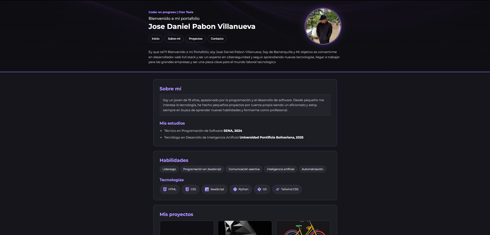
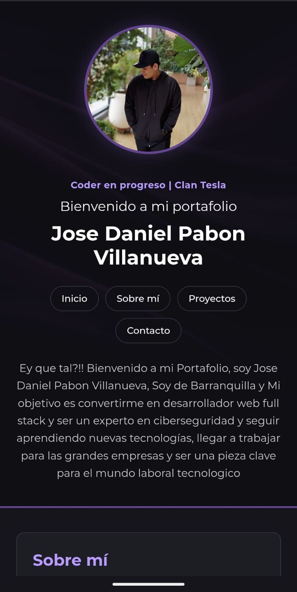

# Portafolio Web - Jose Daniel Pabon Villanueva Coder Riwi
* Mi protafolio en Desarrollo y escalable, con informacion clave, enfocada a la presentacion personal profesional como Futuro Programador

## Demo
* Portafolio publicado en GitPages: https://daniel696996.github.io/Mi-Portafolio/

## Tecnologías

* Devicon y Google Fonts (Montserrat)

## Mejoras aplicadas
* Migración completa de medidas fijas (`px`) a unidades relativas (`rem`) (en base al feedback)
* Diseño responsivo para dispositivos móviles y escritorio
* Vistas previas visuales en las tarjetas de proyectos
* Animaciones sutiles en la navegación y sección de tecnologías

## Capturas de pantalla
* Vista de escritorio: 
* Vista móvil: 

## Estructura del proyecto
* `index.html`: Estructura principal del portafolio.
* `src/input.css`: Archivo fuente de Tailwind CSS.
* `css/output.css`: Hoja de estilos compilada en producción.
* `img/`: Recursos gráficos y vistas previas de proyectos.

## Instalación local
1. Clonar el repositorio: `git clone [URL-de-tu-repositorio]`
2. Instalar dependencias: `npm install`
3. Compilar estilos: `npx tailwindcss -i ./src/input.css -o ./css/output.css --watch`

## Contacto
* Correo: danielpabon899@gmail.com
* GitHub: [github.com/daniel696996](https://github.com/daniel696996)